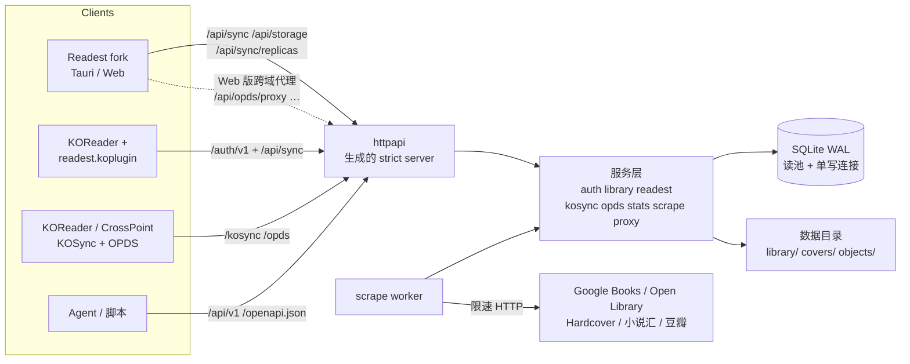
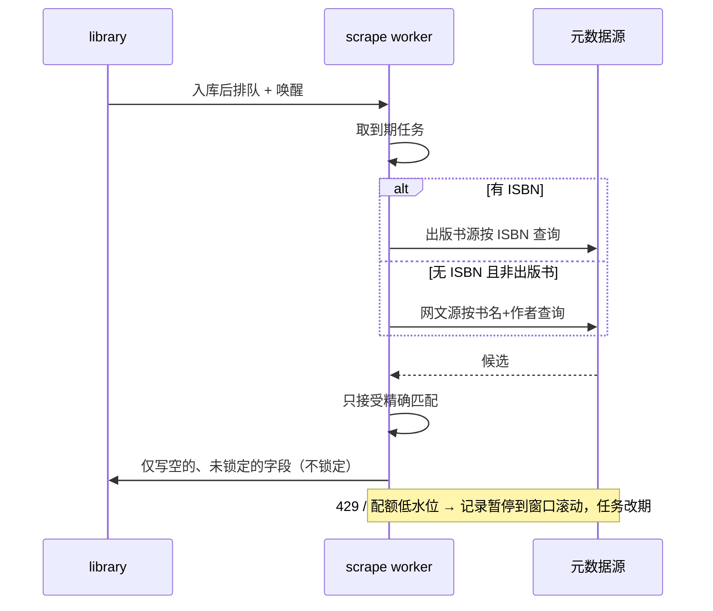

# 架构

BookRoom 是一个进程：Gin HTTP 服务、一个 SQLite 文件、一个数据目录、一个后台刮削 goroutine。设计取舍见 `docs/adr/`，本文讲代码怎么组织、数据怎么流动。

## 分层

| 层 | 包 | 职责 | 手写还是生成 |
|---|---|---|---|
| 契约 | `api/openapi.yaml` | 全部 76 个操作、请求响应结构、鉴权方式 | 手写，唯一真相源 |
| 路由与类型 | `internal/api` | Gin 路由、参数绑定、`StrictServerInterface`、内嵌规格 | oapi-codegen 生成 |
| HTTP 适配 | `internal/httpapi` | 实现 `StrictServerInterface`：把 API 类型翻译成服务调用；按规格的 `security` 鉴权；按协议族渲染错误；规格校验中间件 | 手写，薄 |
| 服务 | `internal/{auth,library,readest,kosync,opds,stats,scrape,proxy}` | 业务规则，不依赖 Gin | 手写 |
| 数据访问 | `internal/store` + `internal/store/db` | 连接池、事务、迁移；类型安全的查询 | 迁移与查询 SQL 手写，Go 代码 sqlc 生成 |
| 入口 | `cmd/bookroom` | `serve`、`import`、`user`、`backup` 命令，依赖装配 | 手写 |

规则：服务只返回 `apperr.Error`（带 HTTP 状态和稳定代码）或普通 error；HTTP 层决定线格式。服务之间只有 `scrape → library`、`readest → library` 两条依赖，`library.ProjectInto` 作为钩子注入 `auth`，避免循环。

## 服务一览

| 包 | 拥有的数据 | 要点 |
|---|---|---|
| `auth` | `users` `refresh_tokens` `devices` | Argon2id 密码；HS256 访问令牌（默认 1 h）+ 轮换的刷新令牌（只存 SHA-256，用过即删）；设备密钥只存 `sha256(md5hex(key))`，正好对上 KOSync 发来的 `x-auth-key`；OPDS Basic 认证的口令校验结果缓存 5 分钟，改密码或吊销即清空 |
| `library` | `library_books`，文件与封面 | partialMD5（与 KOReader 金向量一致）；EPUB OPF / PDF Info / CBZ·CBR ComicInfo / 文件名解析；同一哈希的并发入库串行化；投影进 Readest 书记录（ADR 0013）；元数据编辑、锁定和传播；列表、书单、标签 |
| `readest` | `books` `book_configs` `book_notes` `stat_*` `replicas` `replica_keys` `files` | `/api/sync` 合并规则逐函数移植自 Readest v0.12.20（`merge.go` 与 `pages/api/sync.ts` 同名对照）；存储签名 URL；副本 CRDT（移植 `crdt_merge_replica`） |
| `kosync` | `kosync_progress` `kosync_links` | 协议逐字节兼容；EPUB XPointer 写进 Readest 的书配置，防回退规则照搬 Readest 的 CrossPoint 实现 |
| `opds` | — | OPDS 1.2 Atom：根导航、最新、按书名、在读、书单层级、标签、OpenSearch，25 条一页 |
| `stats` | — | 从 `stat_pages` 实时聚合，按时区切天，连续天数取全部历史 |
| `scrape` | `scrape_jobs` `provider_state` | 五个元数据源（统一 `Provider` 接口）；每源独立令牌桶；配额耗尽持久化暂停；后台只做精确匹配补缺 |
| `proxy` | — | Readest Web 版的跨域代理；拨号时 SSRF 校验（`code.dny.dev/ssrf`），每次重定向重查，跨源去掉凭据 |

## 关键数据流

### 入库

1. 上传流式写进 `tmp/`（受 `BOOKROOM_MAX_UPLOAD_BYTES` 限制）；服务端导入命令则直接硬链接原文件。
2. 计算 partialMD5；已在书库则直接返回（幂等）。
3. 解析内嵌元数据；`TXT`、`MOBI` 等无内嵌元数据的格式从文件名取书名作者（规则移植自 Readest `extractTxtFilenameMetadata`）。
4. 文件放到 `library/<哈希前两位>/<哈希>/<哈希>.<扩展名>`，封面写 `covers/`。
5. 一个事务里：插入 `library_books`；给每个用户插入一条 Readest 书记录（CBR 除外，ADR 0012）；排队刮削任务。
6. 唤醒刮削 worker。

### Readest 同步

- **拉取** `GET /api/sync?since=`：书记录按服务端写入的 `synced_at` 游标（服务端合并改写行时也会推进，不碰 `updated_at`）；配置和批注按 `updated_at`/`deleted_at`；统计按 `updated_at`。带 `limit` 时只返回一页并补齐到最后一个毫秒，客户端用严格的 `> cursor` 不会漏行。
- **推送** `POST /api/sync`：整个批次一个写事务。书记录整行 LWW，阅读状态、封面、元数据组、书单组各有字段级时钟；配置保留被省略的列、朗读包取并集；批注同一 ID 跨书副本按最近变更去重、墓碑优先；翻页事件重复时保留更长的时长；配置里的进度顺带写回书记录。
- **管理员在 Readest 里改元数据**：合并后若该书在书库且元数据时钟更新，写回书库、锁定改动的字段并传播给其他用户。

### KOSync ↔ Readest

`PUT /kosync/syncs/progress` 先存 KOSync 自己的位置；若是 EPUB XPointer（以 `/body` 开头），解析文档 ID 对应的书（已保存的链接 → 书哈希 → 原始文件名的 MD5 → 书名 + 第一作者），再写进该用户的书配置。`GET` 时比较 KOSync 记录与 Readest 配置的更新时间，返回较新的一个。

### 刮削

手动流程：`POST …/metadata/search` 返回打分候选（ISBN 一致 +40、书名作者相似度、封面、来源加权），`POST …/metadata/apply` 写入所选字段并锁定。

## 并发与性能

- 写操作全部走单连接写池，事务以 `BEGIN IMMEDIATE` 开始，不会在事务中途升级锁；读操作走独立读池，WAL 下与写并发。
- 列表用键集分页（游标里是排序列值和哈希），索引覆盖每种排序；计数把书库过滤和用户过滤分开，默认列表不必把每本书都与用户行连接。启动和每小时执行 `PRAGMA optimize`，导入后也执行，保证规划器选中部分索引。
- 两万本书的实测（Xeon E5-2673 v3，`make bench`）：

| 操作 | 耗时 |
|---|---|
| 列表首页 / 按书名 / 第 300 页（键集） | ≈ 2 ms |
| 两字中文搜索 | ≈ 10 ms |
| 罕见词搜索（全表 LIKE） | ≈ 26 ms |
| 按书单 / 按标签 | ≈ 4 / 9 ms |
| 书单树 | ≈ 8 ms |
| Readest 分页拉取 500 本 | ≈ 6 ms |
| Readest 一次推送 100 本 | ≈ 23 ms |
| 新设备一次拉全量 2 万本（含 JSON 编码） | ≈ 550 ms |

## 安全

- 鉴权完全由规格的 `security` 驱动：同一操作的多个方案取或，方案内取与；`bearerAuth: [admin]` 表示仅管理员。共享书库的删除和元数据写入仅管理员可做。
- 存储 URL 是 HS256 签名的 30 分钟能力令牌（独立密钥前缀），绑定用户、对象键和读写方向。
- 代理：仅 http(s)；拨号时拒绝回环、链路本地、私网（可通过 `BOOKROOM_PROXY_ALLOW_PRIVATE` 放行私网，回环始终拒绝）；响应头白名单、非安全 MIME 改为 `application/octet-stream`、加 `CSP: sandbox`。
- 刷新令牌、设备密钥只存哈希；登录对不存在的用户也做一次 Argon2 运算，避免按耗时探测用户名。
- 请求体：上传受配置上限约束，其余 32 MiB。

## 数据表

| 表 | 主键 | 说明 |
|---|---|---|
| `users` `refresh_tokens` `devices` | | 账号与凭据 |
| `library_books` | `hash` | 共享书库，含锁定字段、刮削来源、网文信息 |
| `books` | `(user_id, book_hash)` | Readest 书记录（列名与 Readest 一致） |
| `book_configs` | `(user_id, book_hash)` | 阅读位置、显示设置、朗读包 |
| `book_notes` | `(user_id, book_hash, id)` | 高亮、批注、书签、手写 |
| `stat_books` `stat_pages` | | KOReader 格式的阅读统计 |
| `replicas` `replica_keys` | | 客户端配置 CRDT 与加密盐 |
| `files` | `(user_id, file_key)` | 每用户存储对象（书库文件不在此表） |
| `kosync_progress` `kosync_links` | | KOSync 位置与文档→书链接 |
| `scrape_jobs` `provider_state` | | 刮削队列与元数据源暂停状态 |

时间一律存 UTC 毫秒整数；SQL 基本只用 SQLite 与 PostgreSQL 都支持的写法，例外清单见 ADR 0003。
